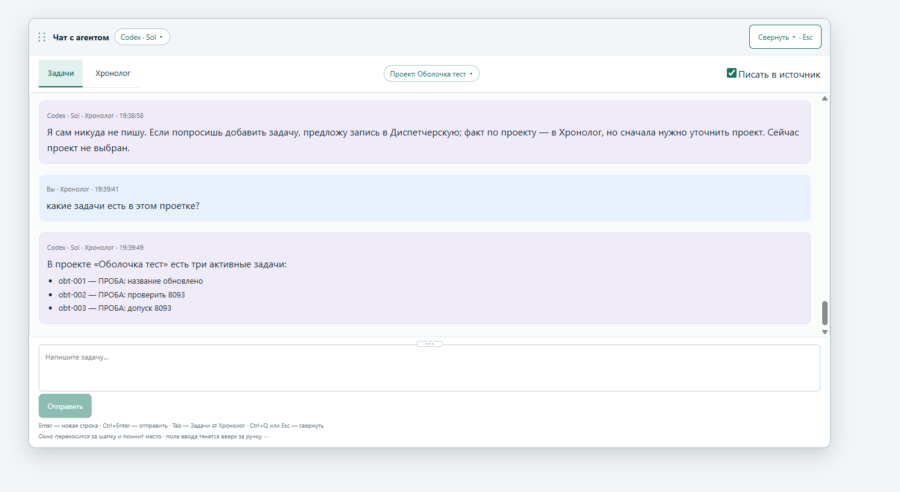
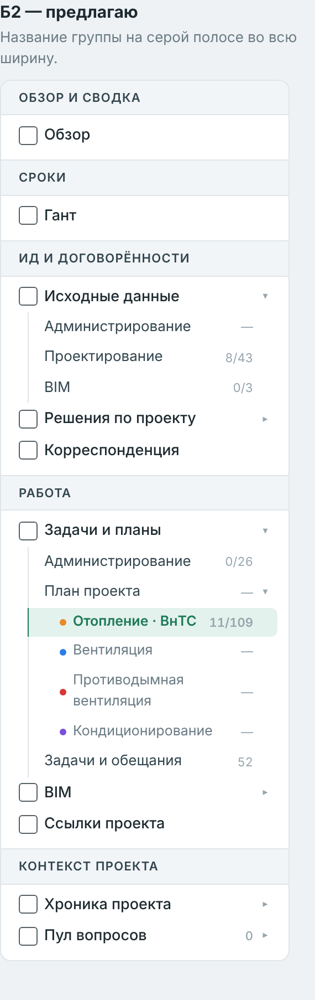
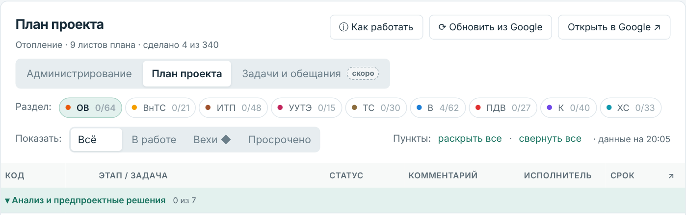
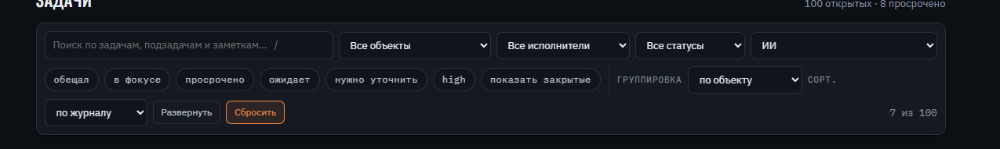
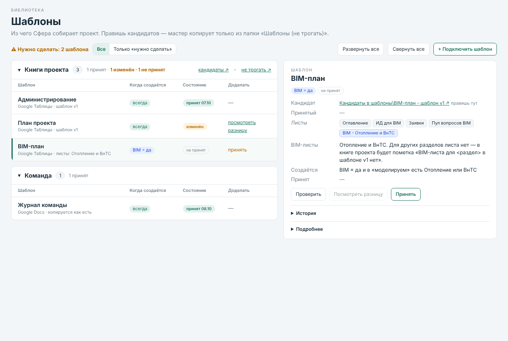

# Сфера — проектная среда

«Сфера» — рабочее окно руководителя проектного отдела. В нём можно открыть паспорт проекта, посмотреть командный план, задачи и историю решений.

Паспорта, свойства проектов, описания и контекст хранятся в Markdown-файлах Obsidian. Команда ведёт планы, администрирование, исходные данные и BIM в Google Таблицах. «Сфера» показывает эти источники в своём интерфейсе и сохраняет поддерживаемые правки обратно в соответствующий источник.

## Модули

По задумке «Сфера» состоит из нескольких модулей. У каждого своя роль в работе руководителя.

| Модуль | Для чего нужен | Состояние |
| --- | --- | --- |
| Проект | Паспорт, исходные данные, решения, планы, BIM и переписка | Основные экраны работают, отдельные сценарии дорабатываются |
| Портфель | Список и карточки проектов, сроки и Гант портфеля | Работает |
| Операционное управление | Задачи и обещания, распределение работы по людям, вход задач через Диспетчерскую | Задачи и обещания работают, планирование недели и сводки развиваются |
| **Хронолог** | Общая лента фактов и решений и отдельная Хроника проекта | Лента работает, новые виды записей и выгрузка проверены на тестовых копиях |
| Главная и обзоры | Обзор проекта и сводки для руководителя | Обзор проекта работает, сводка в планах |
| Команда | Кто на каком проекте работает, загрузка и договорённости | В планах |
| **Картограф и дорожные карты** | Показывать ход работ проекта и использовать эталонные дорожные карты по разделам | В планах |
| Библиотека | Шаблоны, словарь разделов, эталоны и регламенты | Частично |
| Служебные инструменты | Развёртывание проекта, настройки и проверка подключений | Частично |

Встроенный чат с агентом доступен из рабочих экранов. На тестовых данных проверены чтение задач выбранного проекта и сохранение предложенных записей после подтверждения.

## Что уже можно посмотреть

- Паспорт и обзор проекта собираются из заметок Obsidian.
- Привязанные планы и списки открываются из Google Таблиц. Редактирование зависит от настроек проекта и листа.
- В «Сфере» есть Портфель, Задачи и Хроника проекта. Новые виды записей Хронолога 1.4 и их выгрузка в заметки и тестовый лист проверены в песочнице.

### Встроенный чат на тестовом проекте

### Экраны и навигация

Фрагменты интерфейса из макетов. Они показывают меню, фильтры и панели.

Меню проекта

**План проекта** — инженерные разделы, фильтры и этапы.

**Задачи** — фильтры по проектам, исполнителям и статусам.

**Библиотека** — список шаблонов и карточка шаблона BIM-плана.

## Хотелки

Идеи из продуктового реестра. Сроки зависят от приоритетов и обкатки.

- **Портфель и сводки.** Сводки по проекту и по всему портфелю, ближайшие сроки, просрочки и вопросы, которые ждут решения.
- **Планы и Картограф.** Зависимости между задачами разных разделов, недельный план по исполнителям, дорожные карты из эталона, паспорта и плана Google. При обновлении шаблона — показать разницу перед применением к существующим планам.
- **Команда и обещания.** Карточка сотрудника с проектами и ролями, прогноз загрузки, понятное разделение «я обещал» и «мне обещали».
- **Хронолог и агент.** Отчёт за день о том, что агент записал и куда. Связь фактических шагов в Хронологе с узлами дорожной карты. Изменение плана через чат с просмотром правок перед подтверждением.
- **Входящие и совещания.** Повестка и материалы к встрече, разбор входящих из Todoist, Plaud и выбранных чатов мессенджеров.
- **Исходные данные и выпуск документации.** История запросов, разделение внутренних и внешних исходных данных, реестр выданной документации и её версий.
- **Obsidian и Google Таблицы.** Показывать заметку рядом с листом и подсвечивать расхождения между ними.
- **MCP.** Доступ к задачам и Хронике из внешнего агента. Отложено. Сейчас используем встроенный чат.

## Предложения

Что вам приходится вручную сверять между заметками и командными таблицами? Опишите один рабочий сценарий и чего в нём не хватает. [Оставить предложение в Discussions](https://github.com/saeprc-lang/sfera-showcase/discussions/1).