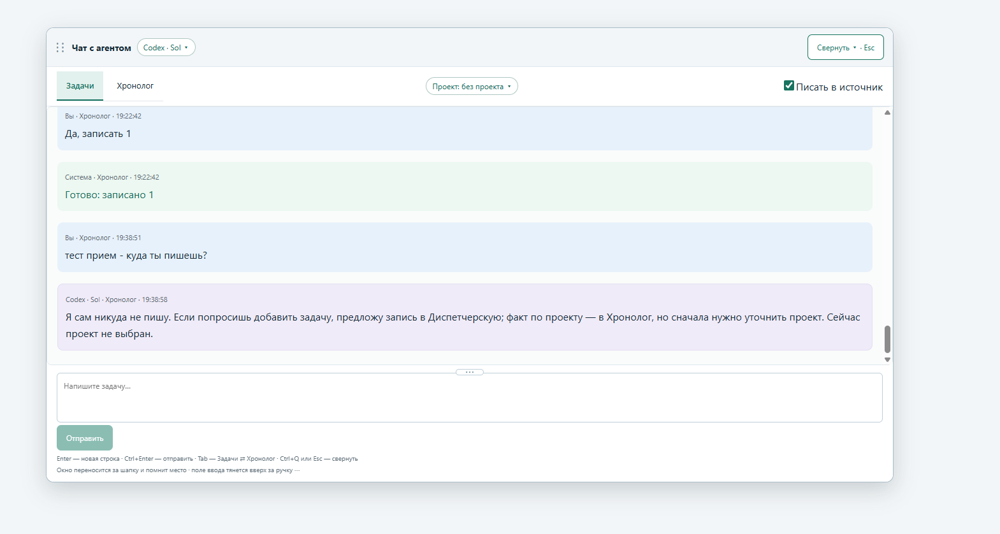

# Сфера — проектная среда

«Сфера» — рабочее окно руководителя проектного отдела. В нём можно открыть паспорт проекта, посмотреть командный план, задачи и историю решений.

Паспорта, свойства проектов, описания и контекст хранятся в Markdown-файлах Obsidian. Команда ведёт планы, администрирование, исходные данные и BIM в Google Таблицах. «Сфера» показывает эти источники в своём интерфейсе и сохраняет поддерживаемые правки обратно в соответствующий источник.

## Модули

По задумке «Сфера» состоит из нескольких модулей. У каждого своя роль в работе руководителя.

| Модуль | Для чего нужен | Состояние |
| --- | --- | --- |
| Проект | Паспорт, исходные данные, решения, планы, BIM и переписка | Основные экраны работают, отдельные сценарии дорабатываются |
| Портфель | Список и карточки проектов, сроки и Гант портфеля | Работает |
| Операционное управление | Задачи и обещания, распределение работы по людям, вход задач через Диспетчерскую | Задачи и обещания работают, планирование недели и сводки развиваются |
| **Хронолог** | Общая лента фактов и решений и отдельная Хроника проекта | Лента работает, новые виды записей и выгрузка проверены на тестовых копиях |
| Главная и обзоры | Обзор проекта и сводки для руководителя | Обзор проекта работает, сводка в планах |
| Команда | Кто на каком проекте работает, загрузка и договорённости | В планах |
| **Картограф и дорожные карты** | Показывать ход работ проекта и использовать эталонные дорожные карты по разделам | В планах |
| Библиотека | Шаблоны, словарь разделов, эталоны и регламенты | Частично |
| Служебные инструменты | Развёртывание проекта, настройки и проверка подключений | Частично |

Встроенный чат с агентом доступен из рабочих экранов. На тестовых данных проверены чтение задач выбранного проекта и сохранение предложенных записей после подтверждения.

## Что уже можно посмотреть

- Паспорт и обзор проекта собираются из заметок Obsidian.
- Привязанные планы и списки открываются из Google Таблиц. Редактирование зависит от настроек проекта и листа.
- В «Сфере» есть Портфель, Задачи и Хроника проекта. Новые виды записей Хронолога 1.4 и их выгрузка в заметки и тестовый лист проверены в песочнице.

### Встроенный чат на тестовом проекте

## Хотелки

- Сводка по проектам для руководителя: что ждёт решения, кто отвечает и какой следующий шаг.
- Отчёт за день: что записали через агента и куда попали записи.
- Сделать обещания понятнее: кто кому обещал и к какому сроку.
- MCP для доступа к задачам и Хронике из внешнего агента. Идея отложена.

## Предложения

Что вам приходится вручную сверять между заметками и командными таблицами? Опишите один рабочий сценарий и чего в нём не хватает. [Оставить предложение в Discussions](https://github.com/saeprc-lang/sfera-showcase/discussions).